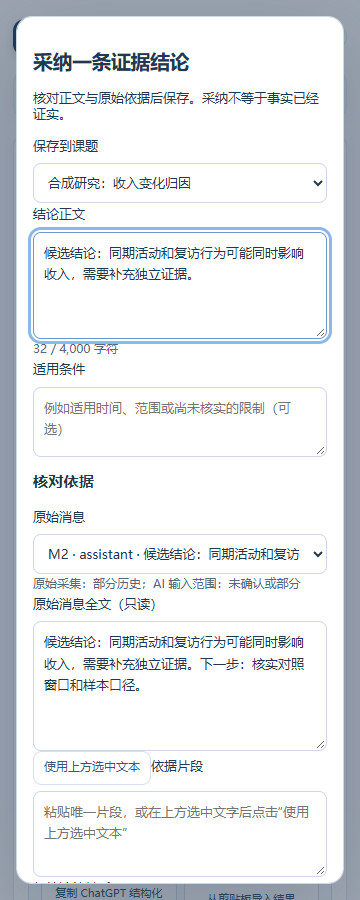

# 截图索引

源提交：3ce5d93040fa44cd3a5dda109da2c87b5343fc0d。全部使用临时浏览器配置和合成研究资料。17 张原图经用户明确授权公开；已逐张检查并核对本轮 SHA-256。图片只包含扩展界面、空状态及虚构研究材料，没有真实账户或研究对话。点击文件名查看原尺寸；复跑 probe.cjs 可生成同名图片。

| 文件 | 字节 | SHA-256 |
| --- | ---: | --- |
| [adoption-dialog-360.png](adoption-dialog-360.png) | 55634 | 173a3110e209c78dd50ea0a6919b5a544b4154fb6aac6adbc4b284cf0a311c3f |
| [amend-dialog-360.png](amend-dialog-360.png) | 65872 | ac70d3b75bbdbebafbbada8f56a36a97eadd1a03a9f79def7b4c7f1d282115c4 |
| [evidence-1-360.png](evidence-1-360.png) | 56365 | 5c49722b77a0b5d8c5db5c87b54ffa08a4b19796f19695af979c911126ec1910 |
| [evidence-10-360.png](evidence-10-360.png) | 183595 | 3e21d0b72ffa896ff16672aae338cf1d2980cf562c85883130db1d5fb147b658 |
| [evidence-200-1280.png](evidence-200-1280.png) | 68750 | 3331b13095cd21f99fc63a76717938760d9a7cbfdd5483ba75ff086e92270cb9 |
| [evidence-200-320.png](evidence-200-320.png) | 55240 | e4eb772daa83857a5403e74622256f180c3f6801d990d4ec69166b86b2c568e5 |
| [evidence-200-360.png](evidence-200-360.png) | 58895 | 186414b53fca9a917c5e0c1c27709499c1a203e97d2e7082b5496d75935c51c3 |
| [evidence-200-768.png](evidence-200-768.png) | 65454 | 809f355a76348890eb664e39db038e29c493510478a75ed496d6aa0e496c7a62 |
| [evidence-50-360.png](evidence-50-360.png) | 58998 | b7718786fb0041c34611631887c2420d0a5ef9ae31a5905fbefccca12171a136 |
| [evidence-empty-360.png](evidence-empty-360.png) | 43694 | dedcddeaafaa1090eedb4a94550c9ec2f947ec73f087c5d448a1a5456528b774 |
| [fork-create-360.png](fork-create-360.png) | 80138 | 7f724c9e03ac709d9da35e84e5254f6662c9aeccc846dfd7dde5318f10e713ab |
| [fork-disabled-360.png](fork-disabled-360.png) | 43657 | 4f6de3305b1e37197752b3b158162eef756005e5f17ec68f563ae7ea81f19537 |
| [fork-frozen-360.png](fork-frozen-360.png) | 114052 | f921db29018d90f4fcf0ccae5bc54e152687f7c3e5519e9e682de18dcdb28069 |
| [manage-empty-360.png](manage-empty-360.png) | 90485 | 9f0b8821548a3394e6a1e90de49721f029dc6d76f562ae29a2546e08ca0127fc |
| [research-empty-360.png](research-empty-360.png) | 33326 | ef3afdd58b168f078cc2747bd8b4e653ef24f603eddd9feca41471804d81babe |
| [research-report-360.png](research-report-360.png) | 139824 | c0cfa549bbb440bc27d9ab419d9b13479ee947275031e0ec2995137e5b522674 |
| [switch-empty-360.png](switch-empty-360.png) | 36960 | 525e21255833203d328bbe597de17ae5b6fddac3f8d81b7ce691ca4eab81916f |

## 代表状态预览

以下为冻结源码的现状截图；设计目标另见 [交互样张](../reference.html)。

### 管理与空状态

### 逐条采纳

### 长列表首屏

### Fork 冻结实验

